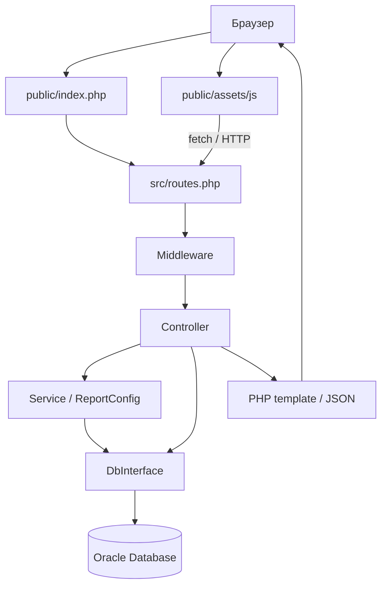

# Архитектура приложения

## Общая схема

Приложение построено на Slim. `public/index.php` — точка входа HTTP-запроса. Он подключает Composer autoload, загружает настройки, создаёт Slim-приложение, подключает маршруты из `src/routes.php` и устанавливает обработчик ошибок.

Код разделён на несколько практических частей:

| Часть | Каталог | Назначение |
|---|---|---|
| Точка входа | `public/` | Приём HTTP-запросов и статические ресурсы |
| Маршруты | `src/routes.php` | Связь URL и HTTP-метода с обработчиком |
| Контроллеры | `src/Controllers/` | Получение параметров, вызов сервисов, формирование ответа |
| Сервисы | `src/Services/` | Повторно используемая бизнес-логика |
| Работа с БД | `src/Database/` | Oracle-подключение и SQL-операции |
| Middleware | `src/Middleware/` | Сессия, авторизация, доступ, обслуживание и ошибки |
| Реестры | `src/Reports/`, `PageRegistry.php` | Конфигурация отчётов, колонок, страниц и прав |
| Шаблоны | `templates/` | HTML, формируемый PHP |
| Frontend | `public/assets/` | JavaScript, CSS, изображения и сторонние библиотеки |
| SQL | `db/` | Oracle-пакеты, миграции и диагностические запросы |

## Что такое контроллер и сервис

**Контроллер** связан с HTTP: читает query-параметры или POST-body, вызывает нужный сервис/класс, выбирает HTTP-статус и формирует HTML либо JSON.

**Сервис** выполняет предметную операцию, которую можно использовать из разных мест. Например, `Organizations` определяет организационный контекст, `MailingService` хранит и проверяет настройки рассылок, `TableLayoutService` сохраняет персональный порядок колонок.

В проекте нет абсолютно строгого правила, что вся SQL-логика обязана находиться только в сервисах: `ApiController` содержит много SQL и условий отчётов. При доработке сначала продолжайте существующий подход соседнего функционала, не перестраивая архитектуру без отдельного решения.

## Схема

## Важные единые реестры

- `src/Services/PageRegistry.php` — каталог страниц, URL, права и навигация.
- `src/Reports/ReportConfig.php` — отчёты, endpoints, фильтры, dimensions, колонки, настройки детализации и контексты страницы/рассылки.
- `src/Reports/source-columns.php` — исходные подписи и метаданные колонок.
- `src/Reports/WagonConfig.php` — конфигурация карточки вагона.
- `src/Services/ConfigSchema.php` — список параметров, типы, значения по умолчанию и проверки.

Не создавайте копии этих реестров в контроллерах или JavaScript.
