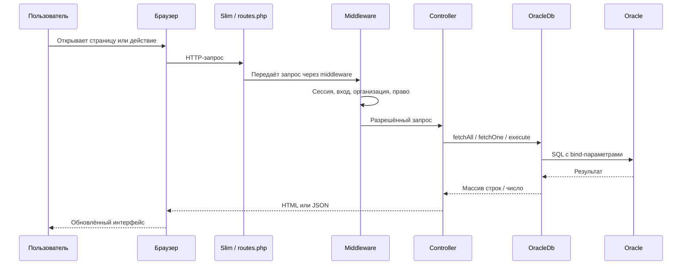

# Жизненный цикл HTTP-запроса

## 1. Точка входа

Файл `public/index.php` выполняет следующие действия:

1. Подключает `vendor/autoload.php`.
2. Загружает конфигурацию через `src/Config.php`.
3. При включённом `app_debug` включает `QueryLogger`.
4. Создаёт Slim через `AppFactory::create()`.
5. Устанавливает `base_path`, если он задан.
6. Включает разбор тела запроса.
7. Подключает `src/routes.php`.
8. Настраивает Error Middleware и собственный `ErrorHandler`.
9. Запускает приложение методом `$app->run()`.

## 2. Конфигурация

`src/Config.php` ожидает файл `rjd_config.php` на уровень выше каталога `src`. Он должен вернуть массив. Затем массив нормализуется `ConfigSchema::normalize()` и сохраняется как текущая конфигурация.

Если файла нет или он возвращает не массив, приложение выбрасывает исключение ещё до регистрации маршрутов.

## 3. Маршрутизация

`src/routes.php` возвращает функцию, принимающую Slim App и конфигурацию. Внутри создаются ленивые функции `$getDb`, `$getAuth`, `$getOrganizations`: объект создаётся при первом обращении и затем переиспользуется в пределах обработки приложения.

Маршруты делятся на публичные, WEB, API, административные и пользовательские. Для API отчётов часть маршрутов создаётся циклом из `ReportConfig::all()`.

## 4. Middleware

На защищённой группе маршрутов подключены:

- `SessionMiddleware` — запускает сессию, создаёт CSRF-токен и синхронизирует активную сессию с реестром;
- `AuthMiddleware` — перенаправляет неавторизованного пользователя на `/login`;
- `OrganizationMiddleware` — устанавливает доступную пользователю организацию и контекст Oracle;
- `PageAccessMiddleware` — проверяет доступ к странице/маршруту.

Также в маршрутах регистрируется `MaintenanceMiddleware`, который проверяет режим технических работ.

Порядок middleware в Slim имеет значение. При изменении порядка обязательно проверьте прямые URL, API, сессию и режим обслуживания.

## 5. Контроллер и результат

Для WEB-страницы контроллер обычно подключает шаблон через `ob_start()`, `require`/`include`, получает HTML из `ob_get_clean()` и записывает его в Response.

Для API `ApiController` возвращает JSON через внутренний метод `json()`. Клиентский `app.js` выполняет запрос и обновляет нужную часть интерфейса.

## 6. Ошибки

`ErrorHandler` определяет HTTP-статус, проверяет, относится ли запрос к API, записывает исключение через `ErrorLogger::logThrowable()` и возвращает JSON или HTML.

Для недоступной БД предусмотрен отдельный шаблон `templates/database-unavailable.php` и статус 503 с `Retry-After: 30`.

Пользователю в production не следует показывать SQL, stack trace и секреты. Для поиска технической причины используется код `ERR-...` и файл журнала `tmp/log/errors/YYYY-MM-DD.log`.

## 7. Схема последовательности

